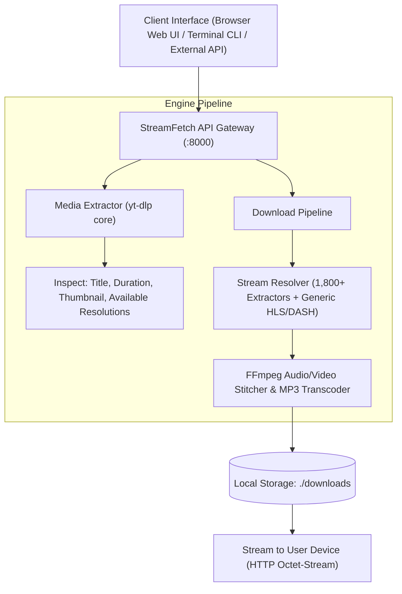

<div align="center">

# ⚡ StreamFetch
### Universal Video & Stream Downloader Engine (Web UI + REST API + CLI)

[](https://github.com/Jayouss/streamfetch/actions)
[](https://www.python.org/)
[](https://fastapi.tiangolo.com/)
[](https://github.com/yt-dlp/yt-dlp)
[](https://ffmpeg.org/)
[](https://opensource.org/licenses/MIT)

<p align="center">
  A high-performance universal media extraction and download engine supporting <b>1,800+ streaming platforms</b> and generic video protocols. Features an embedded single-page <b>Web Dashboard</b>, a standalone <b>FastAPI REST API</b>, and a lightning-fast <b>Terminal CLI</b>.
</p>

[Architecture](#-system-architecture) • [Supported Platforms](#-supported-platforms) • [Quickstart](#-quickstart) • [Web UI](#-web-dashboard) • [CLI Tool](#-cli-usage) • [API Reference](#-api-endpoints)

</div>

---

## 🏛️ System Architecture



---

## 🌐 Supported Platforms

StreamFetch extracts and downloads video and audio streams from **over 1,800 platforms**, including:

| Category | Supported Services |
| :--- | :--- |
| **Social Media** | TikTok (No Watermark), Instagram Reels & Stories, Twitter / X, Facebook Watch, Reddit Video |
| **Video Platforms** | YouTube (up to 4K), Vimeo, Dailymotion, Twitch Clips & VODs, Bilibili |
| **Direct Web Protocols** | Raw `.mp4`, `.webm`, `.mkv` files, HLS (`.m3u8`) playlists, and MPEG-DASH (`.mpd`) streams |
| **Audio Extractors** | SoundCloud, Bandcamp, Mixcloud, YouTube Audio to MP3 192kbps |

> *Note: StreamFetch accesses publicly distributed media streams and does not bypass hardware-encrypted Widevine DRM (e.g. Netflix, Disney+).*

---

## ⚡ Key Engineering Highlights

* **Zero-Friction Web Dashboard**: Embedded single-page web application built with Tailwind CSS. Simply paste any link, inspect thumbnail & formats, and click Download.
* **Smart Stream Stitching**: Automatically merges adaptive video streams with separate high-bitrate audio streams using FFmpeg remuxing.
* **Audio Extraction Engine**: One-click audio extraction to MP3 (192kbps) with automated ID3 tag preservation.
* **Triple-Interface Architecture**: Use it your way:
  1. Open in browser: `http://localhost:8000`
  2. Run via Terminal CLI: `python cli.py "https://..."`
  3. Integrate via REST API: `POST /api/v1/download`
* **Path-Traversal Protected File Server**: Built-in secure file delivery endpoint (`/api/v1/files/{filename}`) with strict directory boundary validation.

---

## 🚀 Quickstart

### 1. Local Installation
```bash
git clone https://github.com/Jayouss/streamfetch.git
cd streamfetch

# Install dependencies (requires FFmpeg on your system)
pip install -r requirements.txt

# Start Server
python -m uvicorn app.main:app --host 0.0.0.0 --port 8000 --reload
```
* Open Dashboard: `http://localhost:8000`
* Swagger API Docs: `http://localhost:8000/docs`

---

### 2. Docker Setup (Includes FFmpeg Pre-configured)
```bash
docker compose up --build -d
```

---

## 🖥️ Web Dashboard

Open `http://localhost:8000` in your browser:

1. **Paste any video URL** into the input field.
2. Click **Fetch Media** to preview thumbnail, duration, uploader, and available resolutions.
3. Select your desired quality (**1080p, 720p, 480p, or Audio MP3**).
4. Click **Download to Device** — the file transfers directly to your local computer!

---

## 💻 CLI Usage

Download media directly from your command line:

```bash
# 1. Download highest available video quality
python cli.py "https://www.youtube.com/watch?v=dQw4w9WgXcQ"

# 2. Download at specific resolution (e.g., 720p)
python cli.py "https://twitter.com/user/status/123456789" --format 720p

# 3. Extract audio only as MP3
python cli.py "https://www.tiktok.com/@user/video/123456789" --audio

# 4. Inspect stream metadata without downloading
python cli.py "https://vimeo.com/123456789" --info
```

---

## 📡 API Endpoints

| Method | Endpoint | Description |
| :--- | :--- | :--- |
| `POST` | `/api/v1/info` | Inspect URL and retrieve title, duration, thumbnail, and format options. |
| `POST` | `/api/v1/download` | Download stream to server directory (`./downloads`) and return file specs. |
| `GET` | `/api/v1/files/{filename}` | Stream and download file directly to user device. |
| `GET` | `/health` | Server health check and download directory status. |

### cURL Example

```bash
# Inspect Video
curl -X POST http://localhost:8000/api/v1/info \
  -H "Content-Type: application/json" \
  -d '{"url": "https://www.youtube.com/watch?v=dQw4w9WgXcQ"}'

# Trigger Download
curl -X POST http://localhost:8000/api/v1/download \
  -H "Content-Type: application/json" \
  -d '{"url": "https://www.youtube.com/watch?v=dQw4w9WgXcQ", "format_type": "720p"}'
```

---

## 🧪 Testing & CI

```bash
# Run pytest test suite
pytest tests -v
```

---

## 📜 License

Distributed under the MIT License. See `LICENSE` for more information.
